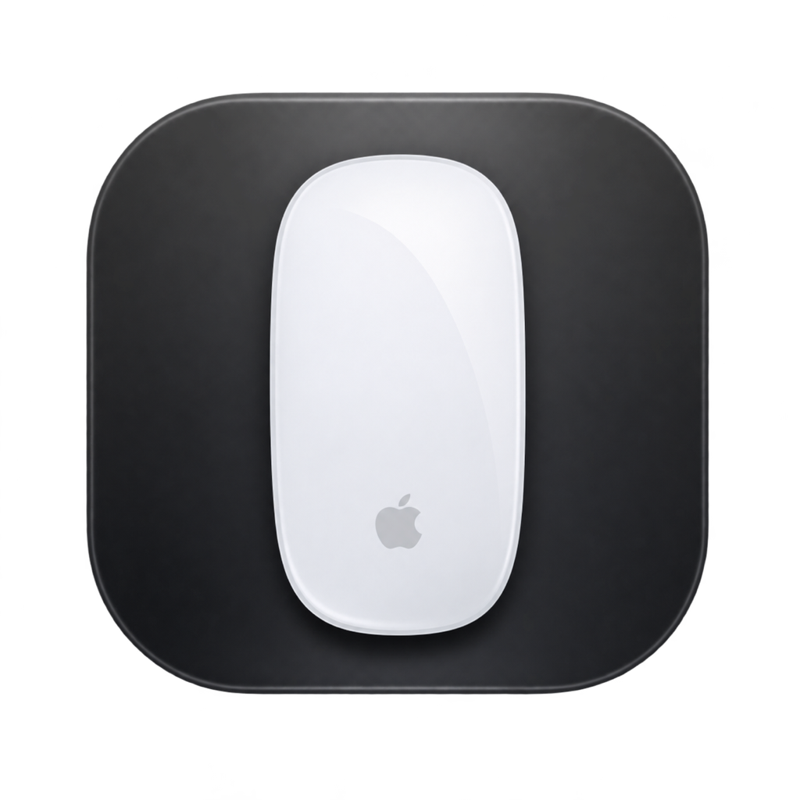

# Magic Pinch

Magic Pinch brings two-finger pinch-to-zoom to the Apple Magic Mouse on macOS. Spread two fingers to zoom in and pinch them together to zoom out, like on a trackpad.

- Continuous pinch-to-zoom in apps that support macOS magnification gestures.
- Adjustable sensitivity, saved automatically.
- Menu bar app with an option to open at login.

## Requirements

- macOS 27 or later and a Magic Mouse with a Multi-Touch surface.
- Xcode Command Line Tools to build the app.

## Install

Build Magic Pinch from source:

```sh
git clone https://github.com/zchengb/magic-pinch.git
cd magic-pinch
sh build.sh
```

Move `build/Magic Pinch.app` to Applications, then open it. The build also runs the gesture, sensitivity, magnification event, and login-launch checks.

The app is locally signed and not notarized. macOS may ask you to confirm that you want to open it. Updating the app may require granting its permissions again.

## Use

1. Allow **Input Monitoring** and **Device Control and Data Access** when prompted.
2. Place the pointer over content in an app that supports pinch-to-zoom, such as Safari or Preview.
3. Use two fingers on the Magic Mouse to zoom. Adjust **Sensitivity** in the Magic Pinch window; `1.0×` is the default.
4. Turn on **Open at Login** to start the app when you sign in. Closing the window leaves Magic Pinch running in the menu bar.

## Permissions and limitations

macOS describes these permissions broadly. Magic Pinch uses Input Monitoring to receive mouse touch data and Device Control to send magnification events. The app does not read keystrokes, record gestures, or connect to the network. It saves your sensitivity setting on your Mac.

Magic Pinch uses undocumented macOS multitouch and gesture interfaces. A macOS update may break them. Zoom support varies by app, and normal mouse scrolling can occur during a pinch.

## License

The source code is available under the [GNU General Public License v3.0 only](LICENSE). See [THIRD_PARTY_NOTICES.txt](THIRD_PARTY_NOTICES.txt) for third-party code and references.

Apple, the Apple logo, and Magic Mouse are trademarks of Apple Inc. Magic Pinch is an independent project and is not affiliated with or endorsed by Apple. No rights to Apple trademarks are granted by this project.
